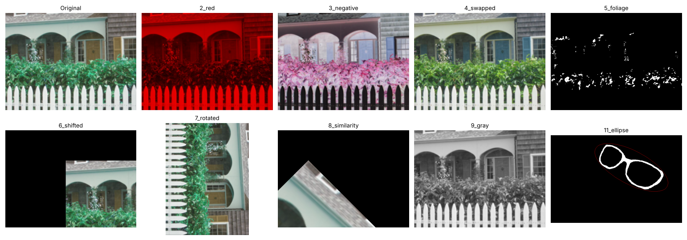
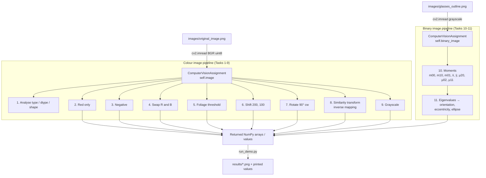
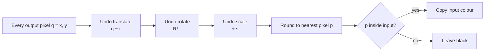

# Computer Vision – Classical Image Processing (EE P 596, HW 1)

Basic image processing and binary image analysis in Python with **OpenCV** and **NumPy**:
colour channels, negatives, thresholding, geometric transforms (translation, rotation,
similarity transform with inverse mapping), grayscale conversion, image moments and
best-fitting ellipse.



---

## Contents

1. [Requirements](#1-requirements)
2. [Project structure](#2-project-structure)
3. [Architecture flow](#3-architecture-flow)
4. [Design](#4-design)
5. [Tasks and methods](#5-tasks-and-methods)
6. [Setup and run (deployment steps)](#6-setup-and-run-deployment-steps)
7. [Reusing the code](#7-reusing-the-code)
8. [Sample results](#8-sample-results)
9. [Troubleshooting](#9-troubleshooting)

---

## 1. Requirements

### Functional requirements (from the assignment)

| # | Task | Requirement |
|---|------|-------------|
| 1 | Load / analyse | Report image type, pixel type (`uint8`) and dimensions |
| 2 | Red image | Set green and blue to 0 |
| 3 | Negative | `255 − pixel` |
| 4 | Swap channels | Swap red and blue |
| 5 | Foliage detection | ON (255) where G ≥ 50, R < 50, B < 50; else 0 |
| 6 | Shift | 200 px right, 100 px down, fill with 0 |
| 7 | Rotate | 90° clockwise, w × h → h × w |
| 8 | Similarity transform | Scale → rotate (clockwise) → translate about the origin; nearest neighbour with **inverse mapping**; output same size |
| 9 | Grayscale | `gray = (3R + 6G + 1B) / 10`, rounded, `uint8` |
| 10 | Moments | First- and second-order (raw + centralized) moments of a binary image |
| 11 | Shape analysis | Orientation (clockwise, degrees), eccentricity, red 1 px best-fitting ellipse via `cv2.ellipse` |

### Non-functional requirements

* Only `cv2`, `numpy` and `os` are used inside `Assignment1.py`.
* Colour outputs are returned in OpenCV's native format: **BGR** channel order, **uint8** pixels.
* Methods **return** results and do not print, save or display anything, so the file is safe for autograders.

### Software

| Package | Tested version | Needed for |
|---------|----------------|------------|
| Python | 3.9 or newer | everything |
| numpy | 2.x | array maths |
| opencv-python | 4.x / 5.x | image I/O and drawing |
| matplotlib | 3.x | *optional*, only for the overview picture in `run_demo.py` |

---

## 2. Project structure

```
ComputerVision-/
├── Assignment1.py        # Main class: all 11 tasks (silent, autograder-safe)
├── run_demo.py           # Runs every task, prints values, saves images to results/
├── requirements.txt      # pip dependencies
├── images/               # Input images
│   ├── original_image.png
│   ├── binary_image.png
│   └── glasses_outline.png
├── results/              # Output images created by run_demo.py
└── docs/
    └── DESIGN.md         # Detailed maths and design notes
```

---

## 3. Architecture flow



**Inverse mapping used in Task 8**



---

## 4. Design

* **One class, one responsibility per method.** `ComputerVisionAssignment` loads images once in
  `__init__`; each task is an independent method that reads `self.image` / `self.binary_image`
  and returns a new array. Inputs are never modified (methods work on copies).
* **Pure functions, no side effects.** No printing, saving or showing inside the class.
  All I/O lives in `run_demo.py`. This keeps the class testable and reusable.
* **Vectorised NumPy.** Every task works on whole arrays (`np.mgrid`, boolean masks, slicing)
  instead of Python loops, so it runs in milliseconds.
* **Native OpenCV format.** BGR + `uint8` everywhere; float is used only temporarily
  (Tasks 8–9) to avoid overflow, then converted back.
* **Coordinate convention.** `x` = column, `y` = row, origin top-left, y pointing down,
  so positive angles appear clockwise on screen.

Full maths for each task: see [`docs/DESIGN.md`](docs/DESIGN.md).

---

## 5. Tasks and methods

| Method | Returns | Key idea |
|--------|---------|----------|
| `load_and_analyze_image()` | `(type, dtype, shape)` | `type()`, `.dtype`, `.shape` |
| `create_red_image()` | BGR image | zero channels 0 and 1 |
| `create_photographic_negative()` | BGR image | `255 − image` |
| `swap_color_channels()` | BGR image | `image[:, :, [2, 1, 0]]` |
| `foliage_detection()` | 1-channel 0/255 | boolean mask `(G>=50)&(R<50)&(B<50)` |
| `shift_image()` | BGR image | `cv2.warpAffine` with `[[1,0,200],[0,1,100]]` |
| `rotate_image()` | BGR image (h × w) | `cv2.rotate(..., ROTATE_90_CLOCKWISE)` |
| `similarity_transform(scale, theta, shift)` | BGR image | `p = Rᵀ(q − t)/s`, nearest neighbour |
| `convert_to_grayscale()` | 1-channel uint8 | `round((3R+6G+B)/10)` |
| `compute_moments()` | 8 numbers | sums over white pixels |
| `compute_orientation_and_eccentricity()` | `(deg, e, image)` | eigenvalues of `[[a,b],[b,c]]` |

---

## 6. Setup and run (deployment steps)

### Step 1 – Get the code

```bash
git clone https://github.com/SaiKeerthi19/ComputerVision-.git
cd ComputerVision-
```

### Step 2 – Create an environment (recommended)

**Option A – venv (any Python install)**

```bash
python3 -m venv .venv
source .venv/bin/activate          # Windows: .venv\Scripts\activate
pip install -r requirements.txt
```

**Option B – Anaconda**

```bash
conda create -n cv-hw1 python=3.11 -y
conda activate cv-hw1
pip install -r requirements.txt
```

### Step 3 – Run

```bash
python run_demo.py        # prints results and saves images into results/
python Assignment1.py     # silent run (no output) – what an autograder does
```

### Step 4 – (Optional) Jupyter

```bash
pip install notebook
jupyter notebook
```

Then in a cell:

```python
from Assignment1 import ComputerVisionAssignment
import cv2, matplotlib.pyplot as plt

cva = ComputerVisionAssignment("images/original_image.png", "images/binary_image.png")
plt.imshow(cv2.cvtColor(cva.create_red_image(), cv2.COLOR_BGR2RGB)); plt.show()
```

Colour images need `cv2.cvtColor(..., cv2.COLOR_BGR2RGB)` before `plt.imshow`;
one-channel images need `cmap="gray"`.

---

## 7. Reusing the code

Use the class on your own images:

```python
from Assignment1 import ComputerVisionAssignment
import cv2

cva = ComputerVisionAssignment("my_photo.jpg", "my_mask.png")

gray   = cva.convert_to_grayscale()
warped = cva.similarity_transform(scale=1.5, theta=30.0, shift=[50, 20])
cv2.imwrite("gray.png", gray)
cv2.imwrite("warped.png", warped)

shape = ComputerVisionAssignment("my_mask.png", "my_mask.png")
angle, ecc, drawn = shape.compute_orientation_and_eccentricity()
print(angle, ecc)
```

Notes:

* `similarity_transform` accepts any scale, angle and shift.
* `shift_image` uses fixed values (200, 100) from the assignment; change the matrix `M` to reuse it.
* The binary image for Tasks 10–11 should be black background with a white shape.

---

## 8. Sample results

Values from the images in this repo:

| Quantity | Value |
|----------|-------|
| Image shape | (321, 433, 3), `uint8` |
| m00 (area) | 11 792 |
| Centroid (x̄, ȳ) | (476.35, 191.22) |
| Orientation | 27.88° clockwise |
| Eccentricity | 0.910 |

---

## 9. Troubleshooting

| Problem | Fix |
|---------|-----|
| `ModuleNotFoundError: No module named 'cv2'` | `pip install opencv-python` (in Jupyter: `%pip install opencv-python`, then restart the kernel) |
| `'NoneType' object has no attribute ...` | The image path is wrong; run from the repo folder so `images/` is found |
| Colours look wrong in matplotlib | Convert BGR → RGB with `cv2.cvtColor` before `plt.imshow` |
| Gray image looks purple/yellow | Use `plt.imshow(img, cmap="gray")` |
| Window freezes | Don't use `cv2.imshow` in Jupyter; use matplotlib |

---

*Course: EE P 596 Computer Vision – Classical and Deep Methods, University of Washington (Fall 2026).*
