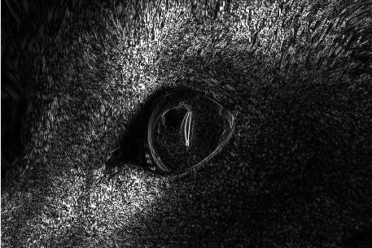
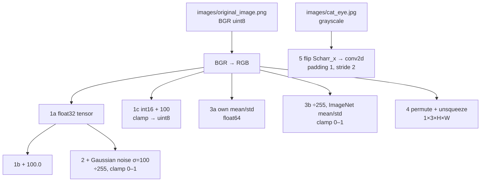
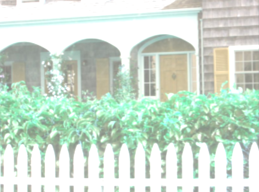
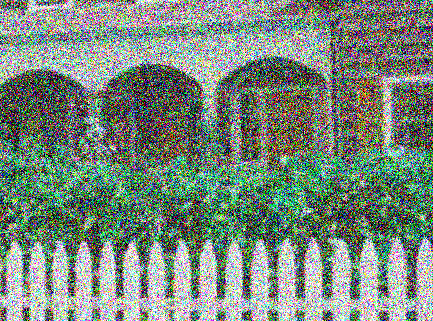
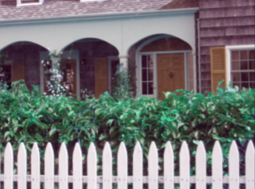

# Homework 3 – Tensor Arithmetic, Augmentation, Normalization and Stride Convolution

PyTorch basics for computer vision: converting OpenCV images to tensors, saturation arithmetic,
Gaussian-noise augmentation, per-channel and ImageNet normalization, NCHW layout and a strided
Scharr convolution.



---

## 1. Requirements

### Functional requirements (from the assignment)

| # | Method | Requirement |
|---|--------|-------------|
| 1a | `torch_image_conversion` | BGR → RGB, to `torch.float32`, shape (321, 433, 3) |
| 1b | `brighten` | add 100.0 to every channel (float32) |
| 1c | `saturation_arithmetic` | RGB, add 100 in `int16`, clamp 0–255, return `uint8` tensor |
| 2 | `add_noise` | Gaussian noise mean 0, σ = 100; divide by 255, clamp to [0, 1], `float32` |
| 3a | `normalization_image` | own per-channel mean/std, `float64`, RGB, no clamp |
| 3b | `Imagenet_norm` | ImageNet mean/std, `float64`, RGB, clamp to [0, 1] |
| 4 | `dimension_rearrange` | H×W×C → N×C×H×W (N = 1), `float32`, RGB |
| 5 | `stride` | 3×3 Scharr_x convolution, zero padding, stride 2, grayscale → 2-D `torch.FloatTensor` |

### Software

| Package | Needed for |
|---------|------------|
| Python 3.9+ | everything |
| torch, torchvision | tensors and convolution |
| opencv-python | image loading |
| numpy, matplotlib | arrays, notebook plots |

---

## 2. Project structure

```
Homework3/
├── Assignment3.py      # Submission code (silent, autograder-safe)
├── Assignment3.ipynb   # Notebook: one cell per task with printed output and pictures
├── run_demo.py         # Prints every result and saves images to results/
├── images/             # original_image.png, cat_eye.jpg
├── results/            # Output images
└── docs/
    ├── DESIGN.md       # Design notes and maths
    └── Report.docx     # Report with outputs
```

---

## 3. Architecture flow



---

## 4. Design

* One class `Assignment3`, one method per question; each returns a new tensor and never prints.
* Colour conversion happens inside each method, so every method accepts the raw OpenCV image.
* Wider integer type (`int16`) for saturation arithmetic to avoid `uint8` wrap-around.
* Broadcasting for per-channel normalization (no loops).
* **Q5:** PyTorch's `conv2d` is cross-correlation, so the kernel is flipped first to get true
  convolution (this is what the autograder expects).

More detail: [`docs/DESIGN.md`](docs/DESIGN.md).

---

## 5. Setup and run

```bash
cd ComputerVision-/Homework3
pip install -r ../requirements.txt torch torchvision
python run_demo.py          # prints results, saves images to results/
python Assignment3.py       # silent run (what the autograder does)
```

Notebook: `jupyter notebook Assignment3.ipynb`, then **Run → Run All Cells**.

---

## 6. Sample results

| Question | Output |
|----------|--------|
| 1a | `torch.Size([321, 433, 3])`, `torch.float32` |
| 1b | max 351.0, `torch.float32` |
| 1c | `torch.uint8`, max 255 |
| 2 | `torch.float32`, range 0.0–1.0 |
| 3a | mean ≈ 0, std ≈ 1 per channel, `torch.float64` |
| 3b | `torch.float64`, range 0.0–1.0 |
| 4 | `torch.Size([1, 3, 321, 433])` |
| 5 | about half the input size, `torch.FloatTensor` |

| | | |
|---|---|---|
|  1b Brighten |  1c Saturation |  2 Noise |
|  3a Own norm |  3b ImageNet norm |  5 Stride |

---

## 7. Troubleshooting

| Problem | Fix |
|---------|-----|
| `No module named 'torch'` | `pip install torch torchvision` (in Jupyter: `%pip install torch torchvision`, restart kernel) |
| `!_src.empty() in function 'cvtColor'` | image not found – run from this folder so `images/` paths work, or put the images next to the script |
| Q5 values all wrong sign | flip the kernel before `conv2d` (true convolution) |
