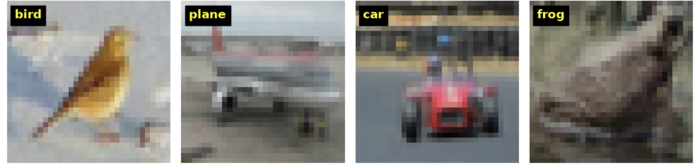
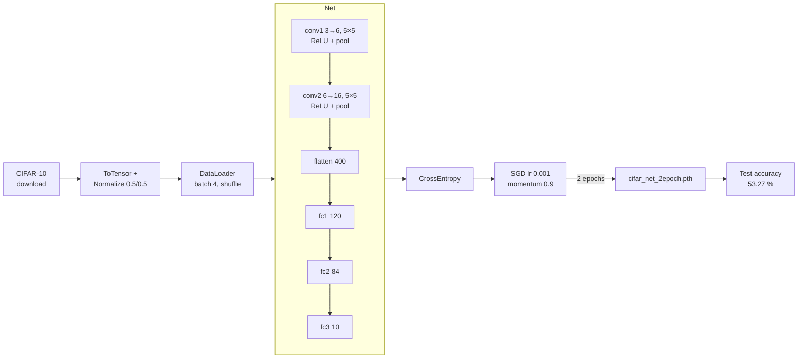
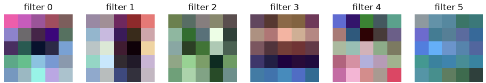
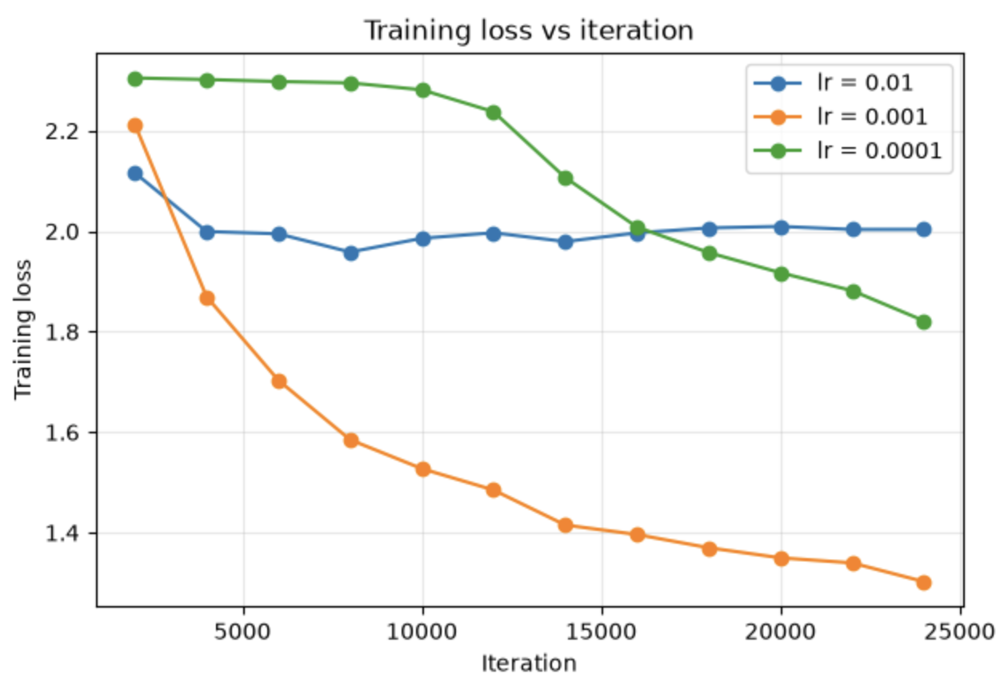
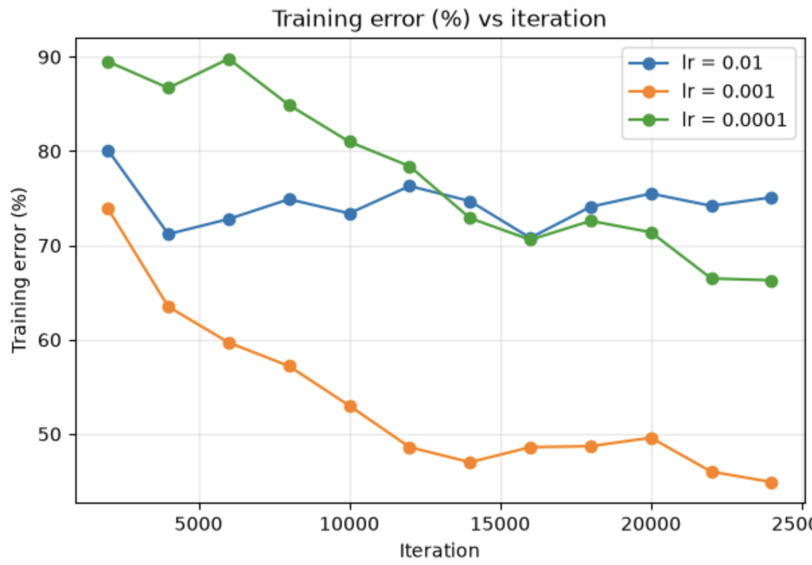
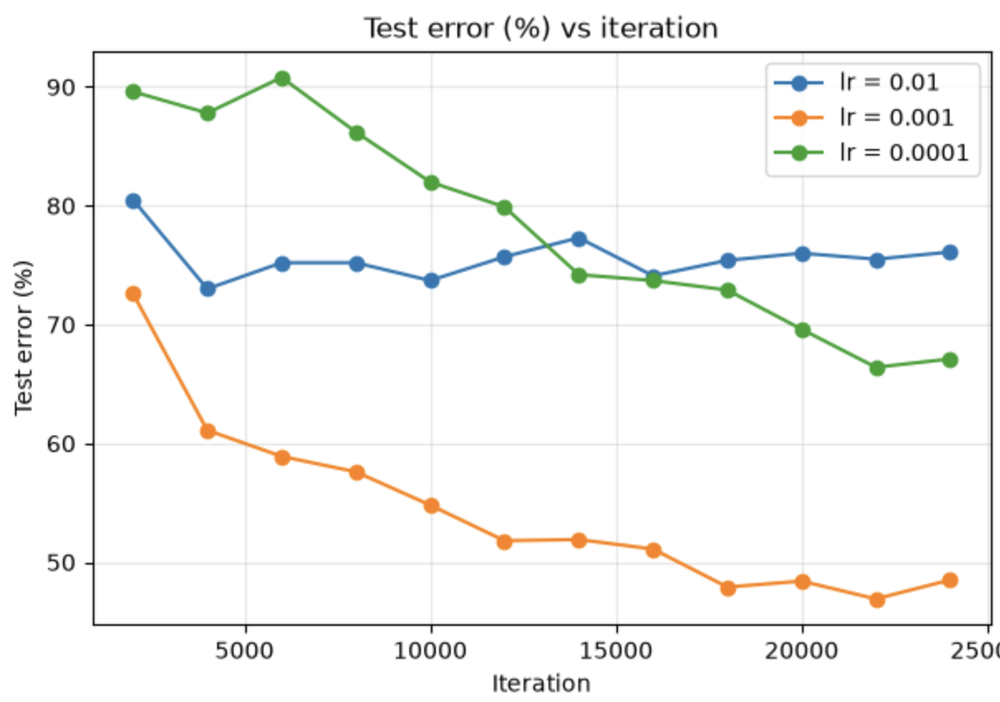

# Homework 4 – CIFAR-10 Image Classification with a CNN

Train a small convolutional neural network on CIFAR-10 with PyTorch, inspect its learned filters,
and compare learning rates.

**Results:** 53.27 % test accuracy after 2 epochs · autograder 60 / 60



---

## 1. Requirements

### Functional requirements (from the assignment)

| # | Function | Requirement |
|---|----------|-------------|
| 1 | – | Report CIFAR-10 facts from `readme.html` (batches, images, sizes) |
| 1a | `CIFAR10_dataset_a` | One random mini-batch of 4 training images as `torch.FloatTensor` (N, C, H, W) + labels; display with labels via `plt.text` |
| 2 | `Net`, `train_classifier`, `evalNetwork` | Tutorial CNN (`conv1`, `conv2`), cross-entropy + SGD with momentum, 2 epochs, save `cifar_net_2epoch.pth`, > 45 % test accuracy |
| 3 | `get_first_layer_weights`, `get_second_layer_weights` | Return conv1 / conv2 weights (no bias) |
| 4 | `hyperparameter_sweep` | lr = 0.01, 0.001, 0.0001; record loss, train error and test error every 2,000 iterations (1,000-image samples); 3 plots + discussion |

### Software

| Package | Needed for |
|---------|------------|
| Python 3.9+ | everything |
| torch, torchvision | dataset, network, training |
| numpy, matplotlib | plots |

---

## 2. Project structure

```
Homework4/
├── Assignment4.py          # Submission code (prints off, autograder-safe)
├── Assignment4.ipynb       # Notebook: one cell per question with outputs
├── cifar_net_2epoch.pth    # Trained weights (53.27 % test accuracy)
├── results/                # Batch image, conv1 filters, sweep plots
└── docs/
    ├── DESIGN.md           # Architecture and design notes
    ├── Report.pdf          # Submitted report
    └── Report.docx
```

The CIFAR-10 data is not stored in the repo; it downloads automatically into `./cifar10` on first run.

---

## 3. Architecture flow



---

## 4. Setup and run

```bash
cd ComputerVision-/Homework4
pip install torch torchvision numpy matplotlib

# Notebook (recommended – shows every output)
jupyter notebook Assignment4.ipynb      # Run → Run All Cells

# Script (trains and overwrites cifar_net_2epoch.pth)
python Assignment4.py
```

Training takes a few minutes on a laptop CPU; the learning-rate sweep about 15–20 minutes.

---

## 5. Results

### Q1 – Dataset facts

| Name | Value |
|------|-------|
| num_train_batches | 5 |
| num_test_batches | 1 |
| num_img_per_batch | 10,000 |
| num_train_img / num_test_img | 50,000 / 10,000 |
| size_image_bytes | 3 KB (32 × 32 × 3) |
| size_batchimage_bytes | 30,000 KB |

### Q2 – Classifier
Loss fell from about 2.21 to 1.30 over 2 epochs. **Test accuracy: 53.27 %** (5,327 / 10,000).

### Q3 – Learned conv1 filters
conv1: (6, 3, 5, 5) · conv2: (16, 6, 5, 5)



### Q4 – Learning-rate sweep

| Learning rate | Final loss | Train error | Test error |
|---------------|-----------|-------------|------------|
| 0.01 | 2.003 | 75.1 % | 76.1 % |
| **0.001** | **1.302** | **44.9 %** | **48.5 %** |
| 0.0001 | 1.822 | 66.3 % | 67.1 % |

| Training loss | Training error | Test error |
|---|---|---|
|  |  |  |

**Takeaway:** 0.01 is too large (loss plateaus near 2.0), 0.0001 is too small (barely learns for
10k iterations), and 0.001 learns steadily and gives the lowest errors. Train and test error stay
close, so there is little overfitting in 2 epochs.

---

## 6. Troubleshooting

| Problem | Fix |
|---------|-----|
| `No module named 'torch'` | `pip install torch torchvision` (Jupyter: `%pip install ...`, then restart kernel) |
| `SyntaxError ... transform =` | you are running the empty template – use this `Assignment4.py` |
| `FutureWarning` about `torch.load` | harmless warning from newer PyTorch |
| Re-running `Assignment4.py` changes accuracy | it retrains and overwrites the `.pth`; keep a copy of the submitted file |
