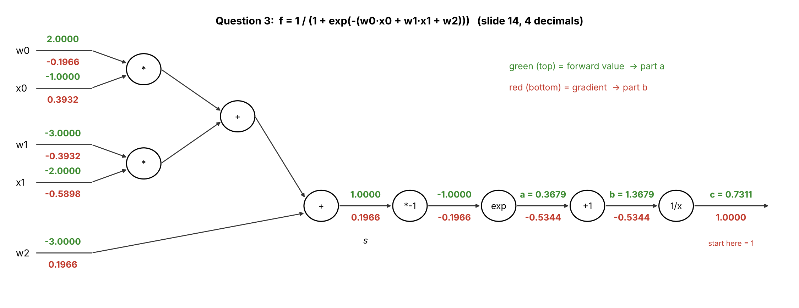
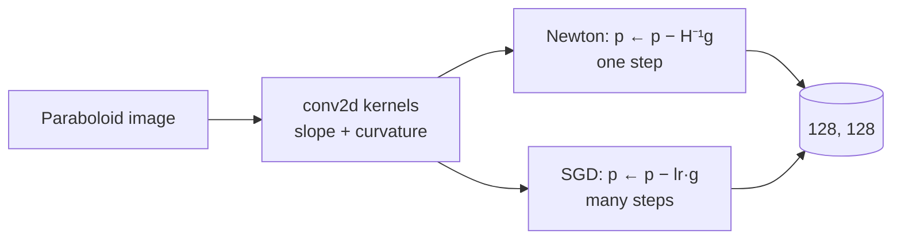
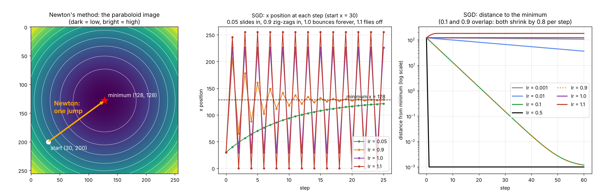

# Homework 5 – Backpropagation, Chain Rule and Optimization

Work out gradients by hand and with PyTorch autograd, do one gradient-descent update on a small
tanh network, and find the minimum of a paraboloid image with Newton's method and gradient descent.

**Results:** all answers match the lecture examples · autograder 100 / 100



---

## 1. Requirements

### Functional requirements (from the assignment)

| # | Function | Requirement |
|---|----------|-------------|
| 1 | `chain_rule` | f = xy + z at x = −2, y = 5, z = −4; return df/dz, df/dq, df/dx, df/dy |
| 2 | `ReLU` | y = ReLU(w0·x0 + w1·x1 + w2) with x = [−1, −2], w = [2, −3, −3]; return dx, dw |
| 3a | `chain_rule_a` | Sigmoid example from the lecture: forward values a, b, c to 4 decimals |
| 3b | `chain_rule_b` | Gradients for w0, x0, w1, x1, w2 with autograd, 4 decimals |
| 4a–c | `backprop_a/b/c` | tanh network, MSE loss with ground truth 1, gradients, one update with lr = 0.1 |
| 5a | `newtonMethod` | Newton's method on the paraboloid image, derivatives from image convolutions |
| 5b | `sgd` | Gradient descent on the paraboloid, stay inside the image |

### Software

| Package | Needed for |
|---------|------------|
| Python 3.9+ | everything |
| torch | autograd, conv2d |
| numpy, matplotlib | paraboloid image, plots |

---

## 2. Project structure

```
Homework5/
├── Assignment5.py          # Submission code (prints off, autograder-safe)
├── Assignment5.ipynb       # Notebook: step-by-step cells for every question
├── results/                # Circuit diagrams and Newton / SGD plots
└── docs/
    ├── Report.pdf          # Submitted report
    └── Report.docx
```

---

## 3. How it works

- **Q1–Q2 (by hand):** forward pass left to right, then backward pass right to left starting from 1.
  An add gate copies the gradient, a multiply gate swaps the inputs, and ReLU (a max gate) passes
  the gradient only when its input is positive.
- **Q3–Q4 (autograd):** build the same graph with `requires_grad=True` tensors and call `backward()`.
- **Q5:** the paraboloid f(x, y) = (x − 128)² + (y − 128)² is a 256 × 256 image. Slopes and curvature
  come from `conv2d` kernels (`[-0.5, 0, 0.5]` and `[1, -2, 1]`), read at decimal positions with
  bilinear interpolation.



---

## 4. Setup and run

```bash
cd ComputerVision-/Homework5
pip install torch numpy matplotlib

jupyter notebook Assignment5.ipynb      # Run → Run All Cells
```

---

## 5. Results

| Question | Result |
|----------|--------|
| Q1 chain rule | df/dz = 1, df/dq = 1, df/dx = 5, df/dy = −2 |
| Q2 ReLU | dx = [2, −3], dw = [−1, −2, 1] |
| Q3a sigmoid forward | a = 0.3679, b = 1.3679, c = 0.7311 |
| Q3b sigmoid gradients | w0 −0.1966, x0 0.3932, w1 −0.3932, x1 −0.5898, w2 0.1966 |
| Q4a tanh forward | ŷ = 0.7616 |
| Q4b gradients | w0 0.2002, w1 −0.8010, w2 −0.2002 |
| Q4c one update (lr 0.1) | w0 4.9800, w1 2.0801, w2 −1.9800 |
| Q5a Newton | (128, 128) in one step |
| Q5b SGD (lr 0.001) | (128, 128) |

### Learning-rate experiment (start at (30, 200))

| Learning rate | Final position | Steps | Behaviour |
|---------------|----------------|-------|-----------|
| 0.0001 | (128, 128) | ~29,000 | very slow |
| 0.001 | (128, 128) | ~4,100 | slow |
| 0.01 | (128, 128) | ~520 | converges |
| 0.1 | (128, 128) | ~60 | fast |
| 0.5 | (128, 128) | 1 | same as Newton |
| 0.9 | (128, 128) | ~70 | zig-zags, then settles |
| 1.0 | (30, 200) | 100,000 | bounces forever |
| 1.1 | (0, 255) | 100,000 | diverges to the edge |



**Takeaway:** each SGD step multiplies the distance to the minimum by (1 − 2·lr). It converges only
for 0 < lr < 1; above 1 it overshoots more every step and diverges.

---

## 6. Troubleshooting

| Problem | Fix |
|---------|-----|
| `SyntaxError` in the template | you are running the empty template – use this `Assignment5.py` |
| `UserWarning: Creating a tensor from a list of numpy.ndarrays is extremely slow` | harmless, comes from the starter line `torch.tensor([constructParaboloid()])` |
| lr = 0.0001 or 1.0 takes a while | it runs many steps (up to the 100,000 limit) |
