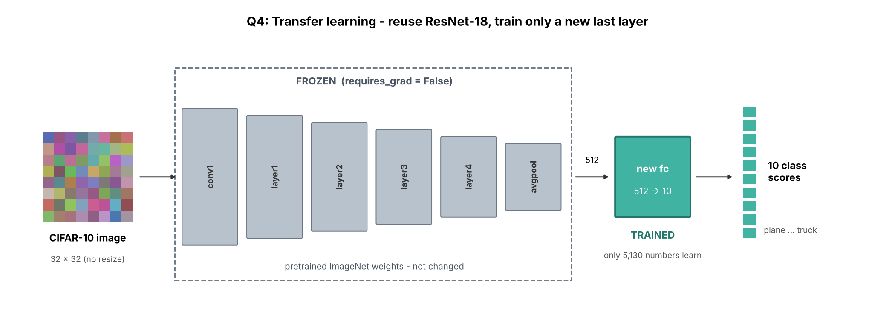
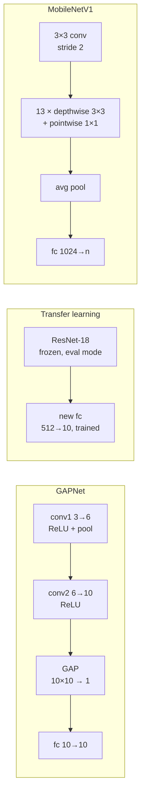
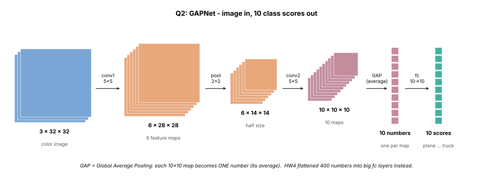
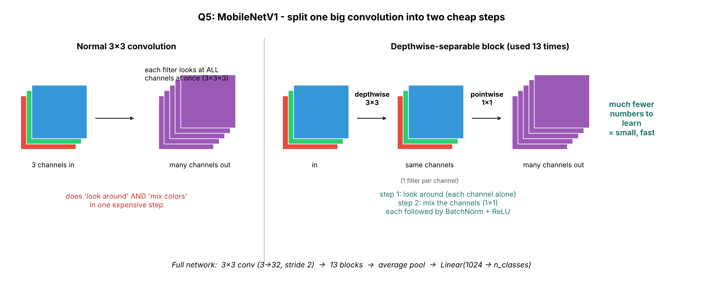

# Homework 6 – Parameters, Global Average Pooling, Backbones, Transfer Learning and MobileNetV1

Count network parameters, train a small CNN with global average pooling on CIFAR-10, use a
pretrained ResNet-18 as a feature extractor and for transfer learning, and build MobileNetV1.

**Results:** GAPNet 53.63 % · ResNet-18 transfer learning 63.00 % · autograder 110 / 110



---

## 1. Requirements

### Functional requirements (from the assignment)

| # | Function | Requirement |
|---|----------|-------------|
| 1 | `compute_num_parameters` | Count trainable parameters of a model (e.g. ResNet-34) |
| 2 | `GAPNet`, `train_GAPNet`, `eval_GAPNet` | conv1 3→6, pool, conv2 6→10, AvgPool2d(10), fc 10→10; 10 epochs, SGD lr 0.001, momentum 0.9; save `Gap_net_10epoch.pth` |
| 3 | `backbone` | ResNet-18 (ImageNet), remove the last fc layer, return features for `cat_eye.jpg` |
| 4 | `transfer_learning` | ResNet-18 (ImageNet), freeze all weights, new 10-class last layer, CIFAR-10 at 32 × 32, 10 epochs; save `Res_net_10epoch.pth` |
| 5 | `MobileNetV1(ch_in, n_classes)` | 3×3 conv (stride 2) + 13 depthwise-separable blocks with BatchNorm + ReLU, AdaptiveAvgPool2d(1), Linear(1024, n_classes) |

### Software

| Package | Needed for |
|---------|------------|
| Python 3.9+ | everything |
| torch, torchvision | models, CIFAR-10, training |
| pillow | loading `cat_eye.jpg` |
| numpy, matplotlib | helpers |

---

## 2. Project structure

```
Homework6/
├── Assignment6.py          # Submission code (prints off, autograder-safe)
├── Gap_net_10epoch.pth     # Trained GAPNet weights (53.63 %)
├── cat_eye.jpg             # Input image for Q3
├── results/                # Diagrams for each question
└── docs/
    ├── Report.pdf          # Submitted report
    └── Report.docx
```

`Res_net_10epoch.pth` (about 45 MB) is not stored here because it is larger than GitHub's 25 MB
web-upload limit. Run `transfer_learning()` to recreate it. The CIFAR-10 data downloads
automatically into `./cifar10` on first run.

---

## 3. Architecture flow



---

## 4. Setup and run

```bash
cd ComputerVision-/Homework6
pip install torch torchvision pillow numpy matplotlib

python Assignment6.py      # Q1 and Q5 (training calls are commented out)
```

To train, uncomment the Q2 / Q4 lines in `__main__`. GAPNet takes about 5–15 minutes on a laptop
CPU; transfer learning uses the Mac GPU (`mps`) or CUDA if available.

---

## 5. Results

| Question | Result |
|----------|--------|
| Q1 | ResNet-34: 21,797,672 trainable parameters |
| Q2 | GAPNet: 2,076 parameters, loss 2.2 → 1.30, **53.63 %** test accuracy |
| Q3 | cat_eye.jpg features: shape (1, 512, 1, 1) |
| Q4 | 5,130 trainable parameters, loss 1.37 → 1.0, **63.00 %** test accuracy |
| Q5 | MobileNetV1(3, 1000): 4,231,976 parameters, 99 modules, output (1, 1000) |

### Q4 – BatchNorm observation

| Setup | Test accuracy |
|-------|---------------|
| ResNet-18 frozen, model in train mode | 24.34 % |
| ResNet-18 frozen, backbone kept in eval mode | **63.00 %** |

In train mode, BatchNorm normalizes over only the 4 images of a batch (and the 32 × 32 inputs
shrink to 1 × 1 in the last layers), so the features change with the batch and the stored ImageNet
statistics drift. Keeping the frozen backbone in eval mode fixes this.

| GAPNet | MobileNetV1 block |
|---|---|
|  |  |

---

## 6. Troubleshooting

| Problem | Fix |
|---------|-----|
| `SyntaxError ... num_para =` | you are running the empty template – use this `Assignment6.py` |
| `UserWarning: The parameter 'pretrained' is deprecated` | harmless warning from newer torchvision |
| `FileNotFoundError: cat_eye.jpg` | put `cat_eye.jpg` in the same folder you run from |
| Transfer learning loss stays near 2.6 | keep the frozen backbone in eval mode (already done in this code) |
