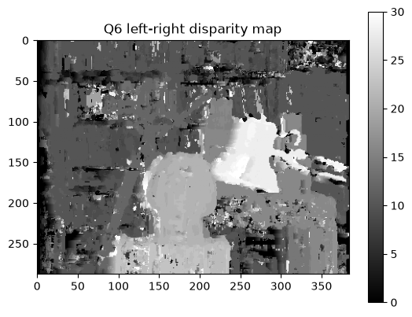
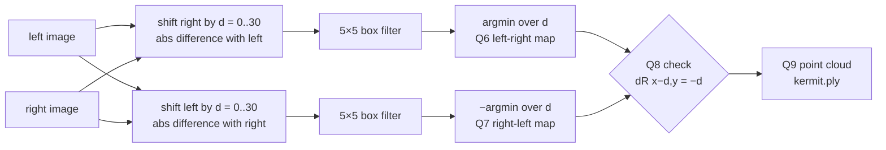
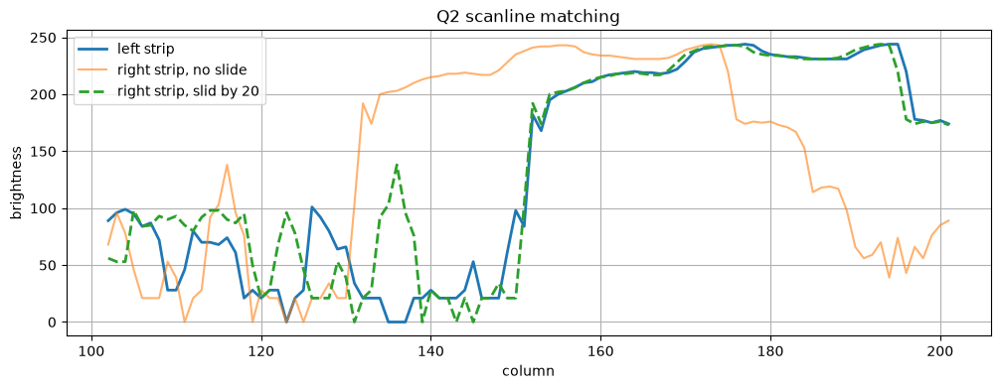
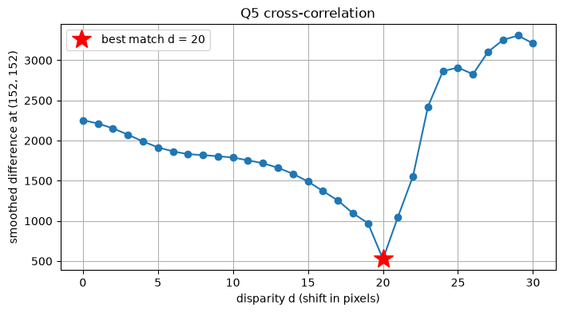
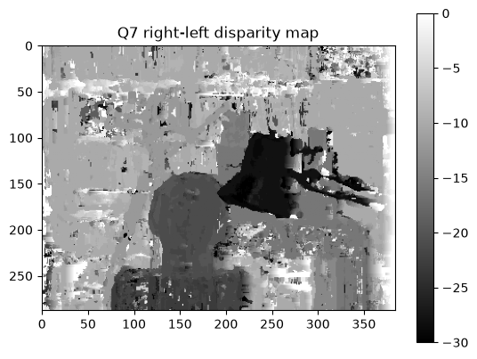
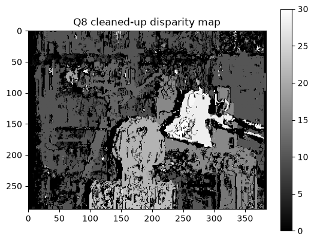
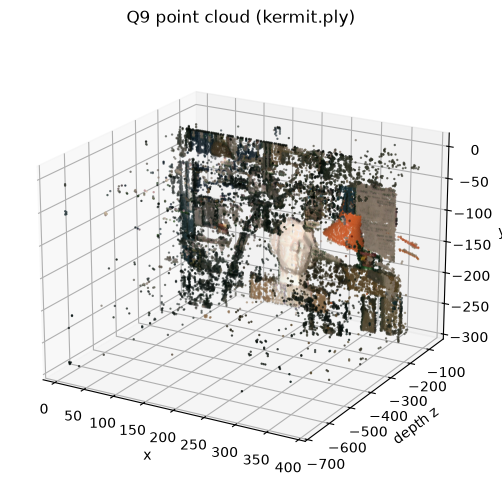

# Homework 7 – Stereo Vision, Disparity Maps and 3D Reconstruction

Match a rectified stereo pair (Tsukuba) row by row, build left-right and right-left disparity maps,
keep only the pixels where both agree, and turn the result into a colored 3D point cloud.

**Results:** scanline disparity 20 · 63.9 % of pixels pass the left-right check · `kermit.ply` with 70,698 points



---

## 1. Requirements

### Functional requirements (from the assignment)

| # | Function | Requirement |
|---|----------|-------------|
| 1 | – | Are the stereo images rectified? (ungraded) |
| 2 | `scanlines` | Row 152, columns 102–201: return the best disparity |
| 3 | `auto_correlation` | Shift the right image by d = 0..30, absolute difference with itself at pixel (152, 152) |
| 4 | `smoothing` | Same, after a 5×5 box filter of ones (no normalization) |
| 5 | `cross_correlation` | Shifted right images compared with the left image at (152, 152) |
| 6 | `disparity_map` | Left-right disparity map: argmin over d of the smoothed differences |
| 7 | `right_left_disparity` | Right-left disparity map (shifted left images vs the right image), negative values −30..0 |
| 8 | `disparity_check` | Keep d only where dR(x − d, y) = −d, else 0 |
| 9 | `reconstruction` | Colored 3D point cloud from the cleaned map, saved as `kermit.ply` (x y z r g b) |

Q2 and Q3 come implemented in the starter code; the `convolve2d_torch()` helper is used for Q4–Q8.

### Software

| Package | Needed for |
|---------|------------|
| Python 3.9+ | everything |
| numpy, opencv-python | images, shifting, argmin |
| torch | 5×5 box filter (`conv2d`) |
| matplotlib | plots |

---

## 2. Project structure

```
Homework7/
├── Assignment7.py          # Submission code (Q1–Q9)
├── HW7.ipynb               # Notebook: step-by-step cells with every plot
├── kermit.ply              # 3D point cloud (70,698 colored points)
├── tsukuba_left.png        # Stereo pair
├── tsukuba_right.png
├── results/                # Plots for Q1–Q9
└── docs/
    ├── Report.pdf          # Submitted report
    └── Report.docx
```

---

## 3. How it works



- **Orthographic projection (Q9):** x = column, y = −row, depth z = −f · b / d with focal length 100 and baseline 20 (nominal values). Colors come from the left image.

---

## 4. Setup and run

```bash
cd ComputerVision-/Homework7
pip install numpy opencv-python torch matplotlib

jupyter notebook HW7.ipynb      # Run → Run All Cells
python Assignment7.py           # writes kermit.ply
```

---

## 5. Results

| Question | Result |
|----------|--------|
| Q1 | Rectified: the same points lie on the same row and only move left/right |
| Q2 | Maximum disparity for the scanline: **20** |
| Q3 | 0 at d = 0, stays about 20–40, jumps to about 220 after d = 21 |
| Q4 | Smoothed curve rises steadily (0, 67, 143, … 5422) |
| Q5 | Minimum at **d = 20** (value 525) |
| Q6 | Left-right map, values 0–30: lamp and head bright (close), shelves dark |
| Q7 | Right-left map, values −30 to 0 |
| Q8 | **63.9 %** of pixels pass the check |
| Q9 | `kermit.ply`, 70,698 colored points |

| Q2 scanline | Q5 cross-correlation |
|---|---|
|  |  |

| Q6 left-right | Q7 right-left | Q8 cleaned |
|---|---|---|
|  |  |  |



---

## 6. Troubleshooting

| Problem | Fix |
|---------|-----|
| `FileNotFoundError` for the images | run from the folder that has `tsukuba_left.png` and `tsukuba_right.png` |
| `SyntaxError` / functions return `None` | you are running the empty starter – use this `Assignment7.py` |
| Q7 shows dark close objects | expected: right-left values are negative |
| `figure/` folder appears | created only when plotting with `plot_result=True` or DEBUG mode |
